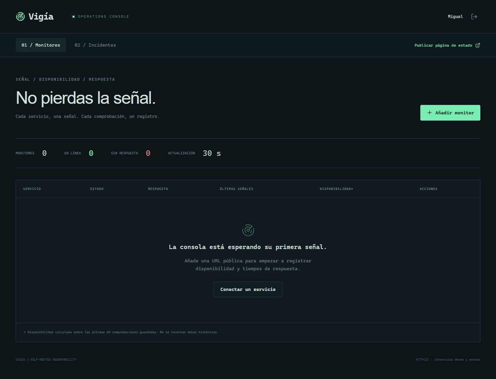

# Vigía

Self-hosted uptime monitoring, response times and public incident status pages.

[](https://github.com/MIGUEL-MOSCOSO-DEV/vigia/actions/workflows/ci.yml) · [Licencia MIT](LICENSE)

Monitoreo de disponibilidad que puedes alojar en tu servidor. Comprueba tus servicios HTTP y comparte su estado sin exponer sus direcciones.



## Qué puedes hacer

- Monitores con intervalos de 1, 5, 15, 30 o 60 minutos, pausa y comprobación manual.
- Historial de respuesta y disponibilidad sobre las últimas 60 comprobaciones.
- Incidentes automáticos al caer un servicio y resolución al recuperarse.
- Comunicaciones manuales y página pública con enlace regenerable.

## Ponerlo en marcha

Necesitas Node.js 22.13 o superior y npm. Se recomienda Node 22 LTS. SQLite viene integrado en Node; no necesitas otro servicio de base de datos.

```sh
git clone https://github.com/MIGUEL-MOSCOSO-DEV/vigia.git
cd vigia
npm ci
npm run dev
```

Abre http://localhost:3400 y crea tu cuenta. La instalación comienza vacía: no hay usuarios, contraseñas compartidas ni registros de demostración.

Crea una cuenta, añade una URL pública y elige el intervalo. Mantén el proceso de Node activo para ejecutar las comprobaciones. Desde Incidentes puedes publicar novedades y generar la página de estado.

## Configuración

Puedes copiar `.env.example` a `.env`. El servidor lo lee al iniciar.

- `PORT`: puerto del servidor; 3400 por defecto.
- `HOST`: interfaz de escucha; `127.0.0.1` por defecto.
- `APP_URL`: dirección pública completa para enlaces y validación del origen.
- `DATABASE_PATH`: archivo SQLite; por defecto `./data/vigia.sqlite`.

Las rutas relativas parten del directorio desde el que ejecutas el proyecto. No publiques `.env` ni los datos.

## Ejecutar en un servidor

```sh
npm ci
npm run build
npm start
```

Configura `APP_URL` con tu dominio HTTPS y coloca el proceso detrás de un proxy inverso que termine TLS. Ajusta `HOST` si tu infraestructura necesita otra interfaz. Mantén Node activo con un gestor de servicios y conserva el directorio de datos entre despliegues. La base necesita almacenamiento persistente.

Las sesiones usan cookies HTTP-only y las contraseñas se almacenan con scrypt. Las rutas privadas comprueban la cuenta propietaria y hay validación de entradas y límites de solicitudes. El registro de cuentas está abierto: quien acceda al servidor puede crear su propio espacio. No incluye recuperación de contraseña por correo ni gestión de miembros.

## Datos y copias de seguridad

Detén el proceso antes de copiar la base SQLite y sus archivos asociados, o realiza una copia coherente con herramientas de SQLite. Guarda las copias fuera de la carpeta pública y comprueba su restauración. `data/`, `.env` y las dependencias están excluidos de Git.

## Alcance actual

Hasta 20 monitores por cuenta y 500 comprobaciones guardadas por monitor. Solo HTTP y HTTPS públicos en los puertos 80 y 443. Se bloquean destinos privados, locales y reservados, también al resolver DNS y seguir redirecciones. No incluye alertas por correo ni comprobaciones desde varias regiones.

## Desarrollo y pruebas

```sh
npm run check
npm run format:check
npm test
npm run build
```

Aislamiento de cuentas, incidentes automáticos, publicación de estado, retención del historial y bloqueo de destinos privados. Las pruebas crean datos temporales y los eliminan al terminar.

React construye la interfaz, Express expone la API y SQLite conserva los datos. `src/` contiene las pantallas, `server/` la lógica y persistencia, `shared/` las reglas compartidas y `tests/` las verificaciones. GitHub Actions ejecuta los controles en cada cambio de la rama principal.

## Contribuir

Abre un issue con los pasos para reproducir el error y el comportamiento esperado. No adjuntes credenciales, archivos privados ni bases de datos. Para proponer cambios, explica qué resuelven y añade pruebas cuando afecten reglas de negocio.

Creado por [Miguel Moscoso](https://github.com/MIGUEL-MOSCOSO-DEV). Licencia MIT.
